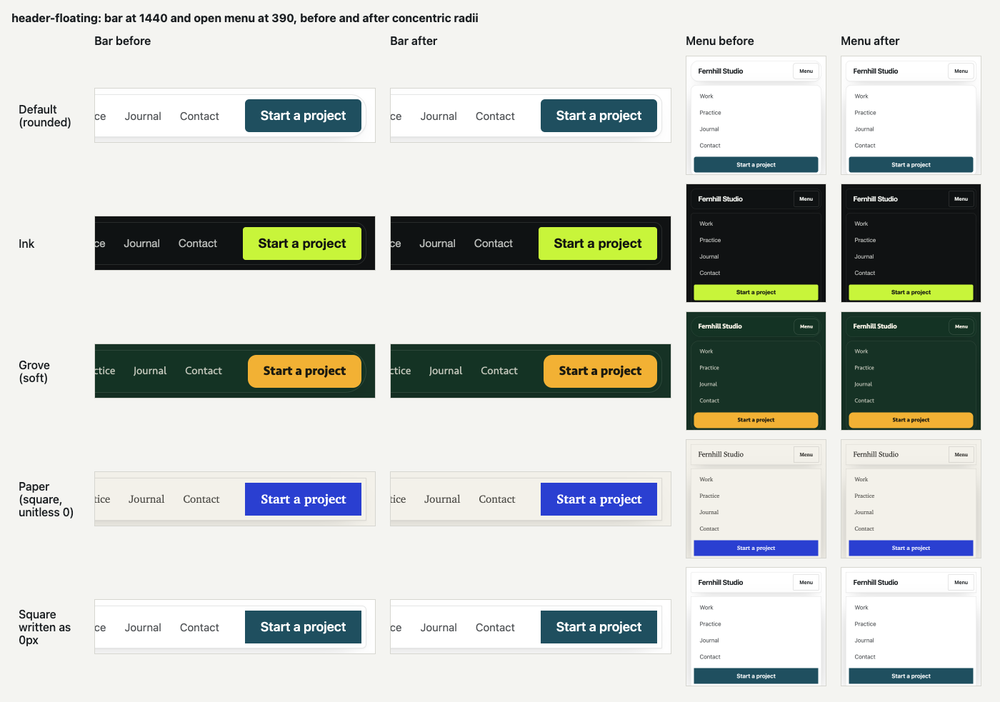

# Astro Blocks audit

**2026-11-28.** This audits `main` at `4753988`, where the items are at v0.1.2. It follows [quality-playbook.md](quality-playbook.md).

**Verdicts for the 18 items:** 11 keep, 7 polish, 0 redesign, 0 hold. header-floating's polish is done in this branch.

Most fixes come from shared causes, listed under "System findings". Fix those once and most rows clear. No item needs a redesign. The defaults are sound, and the problems are about robustness, accessibility and shape consistency.

## Method

- **Gallery renders:** every canvas at 390px and 1440px, in the Default (rounded), Paper (square, serif) and Ink (dark) themes. Headers render in their stage context, above a real opening.
- **Looked at by eye:** every contact sheet, with the normal render, the open menu and the long-copy render side by side.
- **Interaction checks:**
  - menus open, and close on Escape;
  - focus is visible, by comparing pixels with focus on and off, because a computed outline can be clipped;
  - every control is at least 44px.
- **Stress:** long real-world copy, a pasted URL, and images that fail to load.
- **Contrast:** token pairs in four themes.
- **Installed check:**
  - the real shadcn CLI installed tokens, header-floating, hero-split, steps-numbered and footer-cta into a fresh Astro 7.4.13 project;
  - pages composed from the published usage, with tokens, with `0px` square radii, and with no tokens;
  - the same checks run on that site.

```sh
npm run shots -- --themes default,paper,ink --out qa/audit-before --sheet --interact --stress    # 210 shots, 17 sheets
npm run shots -- --themes default,paper,ink --out qa/audit-interact --interact --viewport         # pixel focus check
npm run shots -- --themes default --out qa/audit-stress2 --viewport --stress                      # pasted URL, broken images
npm run shots -- --themes default,paper,ink,grove --contrast --out qa/audit-contrast button
npm run shots -- --base http://localhost:4400 --paths /,/square,/bare --interact --stress --sheet --out qa/installed-check
```

`qa/` is gitignored, so rerun the commands to reproduce the evidence. The installed check's setup is in the playbook.

## Coverage

Every registry item is accounted for. `tokens` has no canvas, so it is covered by the contrast table. Every token a block reads is defined in `tokens.css`, and `npm run check` enforces exact fallbacks.

| Item | Kind | Depends on | Example | Tokens read |
|---|---|---|---|---|
| tokens | foundation | | | defines 40 |
| button | primitive | | ✓ | 7 |
| header-floating | header | button | ✓ + stage | 16 |
| header-editorial | header | button | ✓ + stage | 12 |
| header-transparent | header | button | ✓ + stage | 14 |
| header-minimal | header | button | ✓ + stage | 10 |
| hero-split | hero | button | ✓ | 9 |
| hero-immersive | hero | button | ✓ | 8 |
| hero-typographic | hero | button | ✓ | 8 |
| steps-numbered | walkthrough | | ✓ | 14 |
| timeline | walkthrough | | ✓ | 13 |
| alternating-rows | walkthrough | | ✓ | 18 |
| features-bento | features | | ✓ | 16 |
| features-editorial | features | button | ✓ | 13 |
| footer-minimal | footer | | ✓ | 7 |
| footer-columns | footer | button | ✓ | 13 |
| footer-wordmark | footer | | ✓ | 9 |
| footer-cta | footer | button | ✓ | 13 |

## System findings

1. **Nested shapes weren't related.** The floating header's bar used `--radius-lg` plus 0.375rem around controls that use `--radius-sm`. In Default that's a 22px bar around 6px controls. That is the "square CTA in a round header" Jake saw.
   - The gallery's Paper theme only looked square by accident. Its tokens are unitless `0`, which makes `calc(0 + 0.375rem)` invalid, and the radius then resets to 0.
   - A theme that writes `0px` got a 6px bar around square controls.
   - Fixed for header-floating in this branch with the concentric rule.
2. **Unbreakable strings overflow 10 of 17 blocks.** A URL pasted into body copy overflows by 17px at 390 in these blocks:
   - header-floating, header-editorial;
   - hero-split, hero-typographic;
   - steps-numbered, timeline, alternating-rows;
   - features-bento, features-editorial;
   - footer-cta.

   Only the two headers set `overflow-wrap`, and only on their brand. The fix is `overflow-wrap: anywhere` on each block's root (`qa/audit-wrapfix2`). It is inherited, so one line per block is enough. `break-word` fixed only 7 of the 10 (`qa/audit-wrapfix`), because only `anywhere` lets a flex or grid item shrink below an unbreakable word.
3. **A clipped focus ring.** features-bento draws a linked tile's ring on `::after` with a positive offset, inside a tile with `overflow: clip`. The ring is clipped away, so keyboard focus is invisible on linked tiles (WCAG 2.4.7). Computed styles say the ring exists, so only the pixel check catches this.
4. **Brand links under 44px.** The header-editorial wordmark is 37px at 390. The footer-columns brand is 27–38px.
5. **The gallery hides portability problems.** The usage examples use gallery images (`/gallery/*.svg`, five references), so an installed copy shows broken images. hero-split's narrow layout is a plain grid without `minmax(0, 1fr)`, so a broken image's alt text pushes it 78px past a 390px screen. A loadable image, or `minmax(0, 1fr)`, brings it to 0. Other blocks tolerate broken images.
6. **Spacing and border tokens are defined but unused.** `--space-1` to `--space-8`, `--color-border`, `--leading-body` and `--width-text` are in the contract, but no block reads them. Blocks hard-code rem insets and use `color-mix` borders, so a site's density and border color don't reach them. The README claimed blocks read `--space-*`; this branch corrects that.
7. **Text over images depends on the image.** hero-immersive's strong scrim falls to 50% at 45% of the height. At 390 the copy sits higher than that, over the example's light sail.
8. **Contrast holds.** Every token pair the blocks use passes WCAG in all four gallery themes. The lowest is Paper's muted text on the surface color, at 5.66.

| Theme | text/bg | muted/bg | text/surface | muted/surface | on-accent/accent | accent/bg |
|---|---|---|---|---|---|---|
| default | 16.59 | 6.79 | 15.03 | 6.15 | 8.97 | 8.97 |
| paper | 15.4 | 6.31 | 13.82 | 5.66 | 7.69 | 6.81 |
| ink | 16.38 | 8.11 | 14.77 | 7.31 | 14.63 | 14.83 |
| grove | 12.15 | 8.3 | 9.93 | 6.78 | 9.25 | 7.33 |

## Items

These passed for every item in all three themes: HTTP 200, menus that open and close on Escape, and no overflow with long copy. Exceptions are in the rows. Evidence is in `qa/audit-before/sheet-<item>.png` unless a row says otherwise.

The shared fix for pasted URLs (finding 2) applies to the listed blocks whatever their verdict.

| Item | Verdict | Evidence | Next action |
|---|---|---|---|
| tokens | keep | Contrast table | Decision 4 (unused spacing and border tokens) |
| button | keep | Every variant holds in square, round and dark themes, with long labels | Optional: make `lg` clearly larger than `md`; it's 52px against 44px |
| header-floating | polish, **fixed here** | Before/after table below; `qa/fix-after` passes every check | Ship in v0.1.3 |
| header-editorial | polish | Wordmark link 37px at 390. The nav wraps to two rows and holds | `.wordmark`: `display: inline-flex; align-items: center; min-block-size: 44px` |
| header-transparent | polish | Its mobile panel has the same nesting as header-floating's: a `--radius-lg` panel around a `--radius-sm` CTA, with 0.5rem padding. The scrolled state needs `animation-timeline` and stays non-fixed without it, which is correct | Apply the same concentric radius to `.links:popover-open` |
| header-minimal | keep | Clean at both widths. With long copy at 390, the brand is squeezed beside the CTA | Optional: let the CTA wrap below the brand under 22rem |
| hero-split | polish | Broken image overflows 78px when installed, 50px in the gallery (`qa/installed-check`) | `.inner { grid-template-columns: minmax(0, 1fr) }` for the narrow layout |
| hero-immersive | polish | At 390 the headline sits over the light sail, under about a 50% scrim | Under about 40rem, keep the scrim above 70% across the copy block. Verify with a light image |
| hero-typographic | keep | Strong in every theme | |
| steps-numbered | keep | Four columns at 1440, a ruled list at 390 | |
| timeline | keep | The rail, years and "Now" marker read at both widths | |
| alternating-rows | keep | Media and text alternate; the stat tile works as media; broken images hold | |
| features-bento | polish (accessibility) | Focus invisible on linked tiles: `qa/audit-recheck/features-bento-focus-1440.png`, and all 6 theme × width combinations in `qa/audit-interact` | `outline-offset: -4px` on `.tile-title a:focus-visible::after`, or clip the image instead of the tile |
| features-editorial | keep | The intro and ruled list read well; long copy holds | |
| footer-minimal | keep | One line at 1440, stacked at 390 | |
| footer-columns | polish | Brand link 27–38px | Brand link: `min-block-size: 44px`, centered |
| footer-wordmark | keep | The fitted wordmark holds in sans and serif, and inverts in Ink | |
| footer-cta | keep | Inverted primary plus outline secondary is the right hierarchy | |

## Reference fix: header-floating shape

- **The rule:** the bar's radius is its controls' radius (`--radius-sm`) plus the bar's inset (0.375rem, which is also its padding) and its 1px border. The mobile menu panel is the same, with its 0.5rem inset.
- **Square stays square:** the inset is added only when `--radius-sm` is above 0, written as `min(inset, radius × 100)`. So `0` and `0px` both give square corners, and a pill theme gives concentric pills.
- **Scope:** buttons keep `--radius-sm` everywhere. There is no global pill rule, and the item's `meta.version` goes from 0.1.0 to 0.1.1.

Measured by computed style at 1440 (bar, CTA) and 390 (open panel, panel link):

| Theme | Bar before → after | CTA | Panel before → after | Panel link |
|---|---|---|---|---|
| Default | 22px → **13px** | 6px | 16px → **15px** | 6px |
| Ink | 16px → **11px** | 4px | 10px → **13px** | 4px |
| Grove | 30px → **19px** | 12px | 24px → **21px** | 12px |
| Paper (`0`) | 0px → 0px | 0px | 0px → 0px | 0px |
| Square as `0px` | 6px → **0px** | 0px | 0px → 0px | 0px |
| Pill (`999px`) | → 1006px (pill) | 999px | | |

In the installed check, the fixed header keeps these values: 13px and 6px with tokens, 0 and 0 with `0px` radii, and 13px and 6px with no tokens, through the fallbacks.



## References

These are for judgment, not for copying. No third-party code is in the registry.

- **[Tailwind Plus marketing blocks](https://tailwindcss.com/plus/ui-blocks/marketing):** header, hero, feature and footer sections built by designers. Reference only: the [license](https://tailwindcss.com/plus/license) forbids building a UI library from its components, for sale or for free.
- **[Cloud Four on nested rounded corners](https://cloudfour.com/thinks/the-math-behind-nesting-rounded-corners/):** the concentric rule. A native keyword is proposed in [CSSWG #7707](https://github.com/w3c/csswg-drafts/issues/7707).
- **[Radix Themes radius](https://radix-ui.com/themes/docs/theme/radius), MIT:** one setting, from `none` to `full`, scales every component's corners. This is the model for "square stays square, pill stays pill".

## Gaps

- **Browsers:** Chrome only. Popover, `@starting-style` and the scroll-driven header weren't checked in Safari or Firefox.
- **Stress copy:** injected into rendered text. That approximates long props but doesn't replace a real site.
- **Hosted preview:** its capture runs with JavaScript off. The local `--interact` pass is the interaction evidence.

## Decisions

1. **Release v0.1.3 as one mechanical robustness batch.** It would carry:
   - this shape fix;
   - `overflow-wrap: anywhere` on the 10 blocks;
   - the bento focus ring;
   - the two brand targets;
   - hero-split's `minmax(0, 1fr)`;
   - header-transparent's concentric panel.

   Each is a line or two, verified by `npm run shots -- --interact --stress`. After the merge: bump the version and the `#v…` references, tag, and pin the new version in Site Boulder. I'd ship it as one batch.
2. **Usage example images:** use portable placeholders instead of `/gallery/*.svg`, so pasted usage never ships a broken image. For example, the `media` slot with a small inline SVG, or a data URI. The alternative is to keep the gallery paths and say "replace this image". I lean toward portable placeholders, because agents paste usage as-is.
3. **hero-immersive scrim:** guarantee 4.5:1 behind the copy by default, and keep today's look as `scrim="soft"`. This is a look decision.
4. **Spacing and border tokens:** either have blocks read `--space-*` and `--color-border` in a later minor release, one category at a time with before/after sheets, or remove them from the contract. I lean toward adopting them, because they make a site's theme carry further.
5. **The button's `lg` size:** keep it subtle (52px against 44px), or make it a distinct hero size. This is low priority and purely a look decision.
